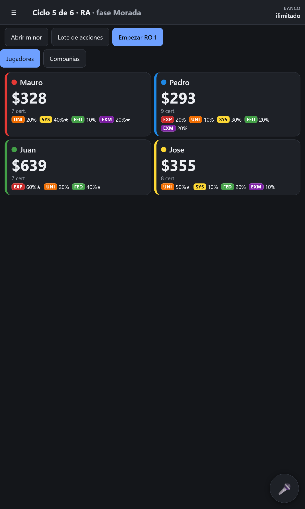
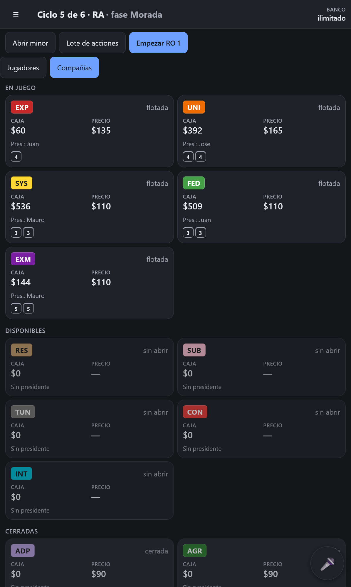
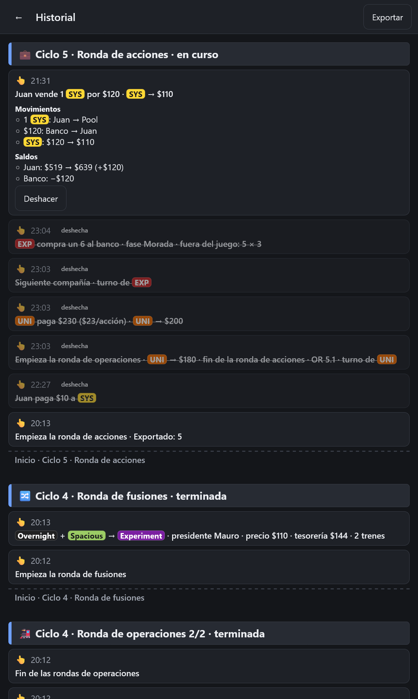

# 18xx Companion

[](https://github.com/Mancifer/18xx-companion/actions/workflows/ci.yml)

An offline-first PWA that keeps the money for [18xx](https://en.wikipedia.org/wiki/18xx) board games, by touch or by voice.

> **18xx in one line:** a family of railway-themed stock and operating games where players trade shares and companies run trains and pay dividends, which means a lot of arithmetic at the table.

It handles the bookkeeping that slows games down (bank, player cash, company treasuries, share ownership, dividends, making change with poker chips) so players keep their attention on the board. It is **not a rules engine**: map, routes and tile placement stay on the table, and every value can be overridden when the app and the table disagree.

**Live demo:** [https://18xx-companion-1hn.pages.dev/](https://18xx-companion-1hn.pages.dev/)

**Screenshots:** 
<p>
  
  
  
</p>

> The interface and voice commands are currently in **Spanish**. Strings live in `src/domain/i18n`.

## Features

- **Games:** 1830, 1848, 21Moon and Railways of the Lost Atlas (Long, Short and Micro modes), plus a custom game based on a built-in one
- **Money tracking:** player and company cash, share ownership, bank with a chip breakdown for every transaction, configurable chip denominations
- **Operating rounds:** dividends (full payout, withhold, half-pay where the game allows it), stock market price moves with manual override, an income summary at the end of each OR
- **History:** every change is recorded in an append-only ledger, with undo and a history view that shows where the money went
- **Voice commands (optional):** hold a button, speak, review the proposed action, confirm with one tap
- **Offline and installable:** all data stays on the device, with export/import of games and a game results page

## Supported games

| Game | Status |
|---|---|
| 1830 | implemented, not yet played |
| 1848 | implemented, not yet played |
| 21Moon | implemented, not yet played |
| Railways of the Lost Atlas | Tested in real play |

Unit, UI and end-to-end tests cover the calculation logic for all supported games. "Tested in real play" means used in an actual game session.

## Voice commands

Voice is optional and off until you add your own API key in Settings.

1. Hold the microphone button and speak (push-to-talk only; nothing is captured otherwise).
2. The browser's speech recognition turns audio into text.
3. The transcript and the game state are sent to the configured AI provider (Anthropic Claude or Google Gemini), together with the list of actions the app allows.
4. The model must answer with a structured action from that list, validated with Zod. Anything else is rejected.
5. A confirmation card shows what was heard and what will happen. Nothing changes until you tap to confirm, and everything can be undone.

Privacy:

- Audio is processed by the browser's speech service (in Chrome, by Google). Only the transcript and game state go to the AI provider.
- On Gemini's free plan, Google may use prompts and responses to improve its products. The app shows this notice in Settings.
- API keys are stored on the device only, can be set to not be remembered, and are never included when exporting a game.
- The app calls the providers directly from the browser using your key. There is no backend.

Currently, speech recognition uses Web Speech API, which is limited to Chrome and Edge on destkop and Android.

## Design decisions

- **Event-sourced ledger.** State is derived by reducing an append-only log of events. The UI and the voice layer never mutate state directly; they emit validated actions. This gives undo, history, export and crash recovery from one mechanism.
- **Money is conserved.** Bank + players + companies equals the starting total. A broken invariant means a bug or a misheard command, and the app shows it.
- **Propose, confirm, undo.** AI-proposed actions are shown before anything is applied. Confirmation is a single tap, because two would defeat the point of using voice over touch.
- **History without redo or editing the past.** Undo works newest-first, with a confirmed "undo back to here" for older entries. Reverted entries stay in the ledger. An earlier version allowed out-of-order undo and amending entries, but later entries had been computed from a game state that no longer existed (see `.specify/bugs/undo-stale-market-move`), so those features were removed in favor of a history that is always consistent.
- **Rules as configuration.** Differences between games live in game definitions (data), not in per-game code paths.
- **Strict security posture for a client-only app.** A Content-Security-Policy limits network access to the two AI providers, response headers deny framing, and e2e tests cover the key-handling rules.

## Tech stack

React 19, TypeScript, Vite, `vite-plugin-pwa`, IndexedDB (`idb`), Zod, Vitest, Testing Library, Playwright, ESLint, GitHub Actions. Requires Node 22 or newer.

## Getting started

```bash
git clone https://github.com/Mancifer/18xx-companion.git
cd 18xx-companion
npm ci
npm run dev
```

| Script | What it does |
|---|---|
| `npm run build` / `npm run preview` | Type-check and build, then serve the build on port 4173 |
| `npm test` | Unit and UI tests (Vitest) |
| `npm run test:e2e` | End-to-end tests (Playwright) |
| `npm run typecheck` / `npm run lint` | TypeScript and ESLint checks |
| `npm run eval:voice` | Run the voice evaluation against a real model (needs `ANTHROPIC_API_KEY` or `GEMINI_API_KEY`; this spends money) |

CI runs type-check, lint, tests and `npm audit` on every push and pull request.

## Voice evaluation

`eval/voice` contains 91 Spanish voice-command cases with game-state fixtures, used to compare models and prompts. The committed results show, for example, a run on 2026-10-13 with `gemini-3.6-flash` scoring 98.9% overall across the 91 cases. Treat these numbers as a snapshot of one run, not a guarantee.

## Project structure

```
src/domain       game definitions, actions, event ledger, mechanics, i18n
src/persistence  IndexedDB repositories, export/import
src/voice        speech capture, prompt, providers (Anthropic, Gemini)
src/ui, src/app  screens, sheets, components, stores
tests, e2e       unit/UI tests and Playwright end-to-end tests
eval/voice       voice evaluation harness, cases and fixtures
specs, docs      feature specs and the product spec
```

## How it was built

This project uses spec-driven development with [GitHub Spec Kit](https://github.com/github/spec-kit) and Claude Code (VS Code extension). The process is visible in the repository:

- `specs/` has 13 numbered feature specs, each with plan, tasks and research
- `.specify/memory/constitution.md` holds the project principles (versioned)
- `.specify/bugs/` documents bugs found while playing and testing, each with an assessment, a fix and a regression test
- `docs/spec.md` is the overall product spec

## Known limitations

- 1830, 1848 and 21Moon haven't been played at a table yet (covered by automated tests for now)
- No redo (see design decisions)
- Spanish only for now
- Chip suggestions are approximate. The app suggests how to make change but doesn’t enforce the chip supply entered during setup, so it may suggest paying out chips the bank doesn’t have. Players make change among themselves all the time, so tracking the physical supply exactly would disrupt play. Treat the suggestions as a guide.

## Roadmap 

- English language support
- Whisper-based speech recognition via Groq as a cross-browser alternative to the browser's recognizer
- Better visual layout for tablets and large screen devices
- Visual polish (buttons, layout, clearer notifications)

## Legal

This project contains no rulebook text or copyrighted game content. 18xx game names and rules belong to their respective designers and publishers.

## License

MIT, see [LICENSE](/LICENSE)
